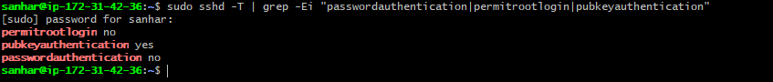
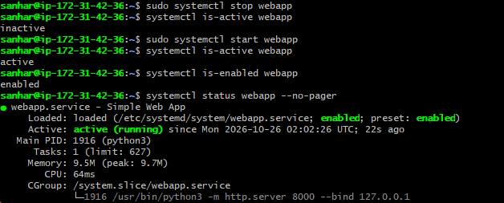
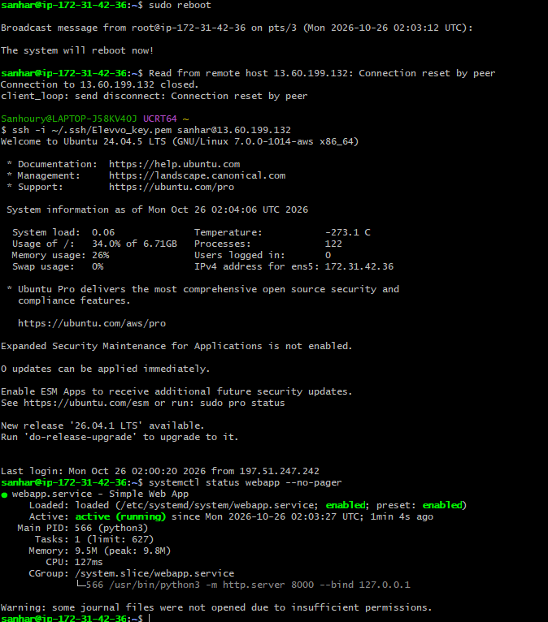

# Secure Linux Bastion Host and Process Management

## What I built
An Ubuntu 24.04 server on AWS EC2 (t3.micro), hardened for SSH access, running a small web service managed by systemd.

## Steps
1. Launched the EC2 instance with an Ed25519 key pair.
2. Created a non-root admin user (sanhar) with sudo and installed my public key.
3. Hardened sshd: password login off, root login off, key authentication only (see configs/sshd-hardening.conf).
4. Verified with sshd -T and with failed login attempts (screenshots/).
5. Created a web app and ran it as a systemd service (configs/webapp.service).
6. Practiced the lifecycle: start, stop, restart, enable on boot, and confirmed it survives a reboot.

## Commands used
    sudo systemctl daemon-reload
    sudo systemctl start webapp
    sudo systemctl enable webapp
    sudo systemctl status webapp
    sudo sshd -T | grep -Ei "passwordauthentication|permitrootlogin|pubkeyauthentication"

## Evidence
 ### 1. SSH hardening: password login and root login refused
   

   ### 2. Effective sshd settings
   

   ### 3. systemd service lifecycle (stop, start, enabled on boot)
   

   ### 4. Service running after a reboot
   

## What I learned
- Key-based SSH is safer than passwords, and extra files in /etc/ssh/sshd_config.d/ can override the main config.
- systemd restarts crashed services (Restart=always) and starts them at boot (enable).
- Always test a new SSH session before closing the old one.
