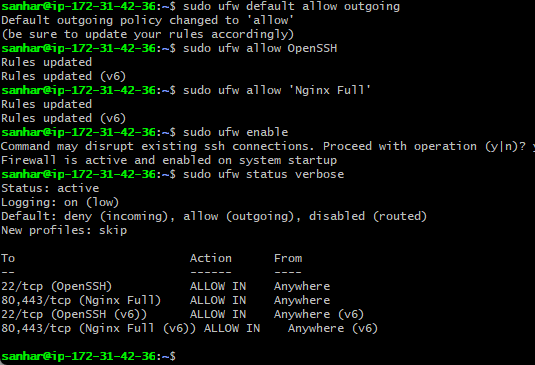
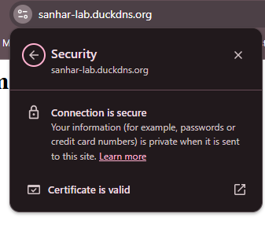
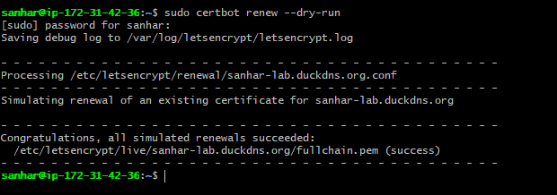
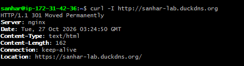
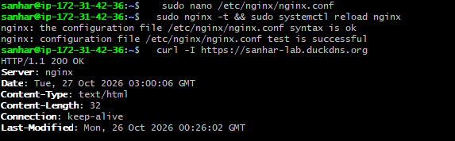
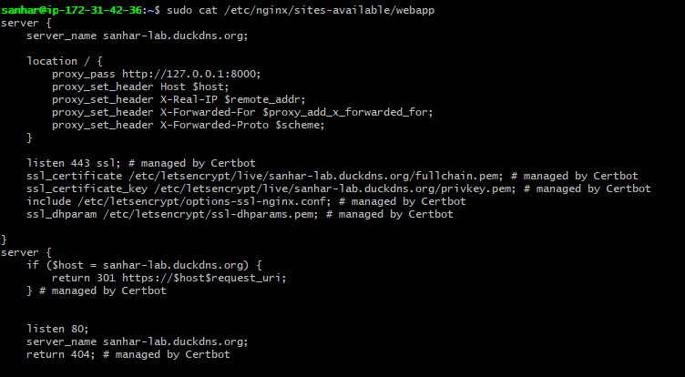

# Task 2: Reverse Proxy and Perimeter Firewall

## What I built
Nginx as a reverse proxy in front of my systemd web app (127.0.0.1:8000), a default-deny UFW firewall, and HTTPS with an auto-renewing Let's Encrypt certificate.

## Steps
1. Pointed a DuckDNS domain at the EC2 public IP.
2. Installed Nginx and proxied port 80 to the app (configs/webapp.nginx.conf).
3. UFW: default deny incoming, allowed only OpenSSH and Nginx Full.
4. Issued a certificate with Certbot and verified renewal with `certbot renew --dry-run`.
5. Bonus: HTTP to HTTPS redirect (301) and `server_tokens off;` to hide the Nginx version.

## Commands used
    sudo ufw default deny incoming
    sudo ufw allow OpenSSH
    sudo ufw allow 'Nginx Full'
    sudo ufw enable
    sudo certbot --nginx -d sanhar-lab.duckdns.org
    sudo certbot renew --dry-run
    curl -I https://sanhar-lab.duckdns.org

## Evidence

### 1. UFW firewall: default deny, only SSH and Nginx allowed

### 2. HTTPS working (secure connection)

### 3. Certificate auto-renewal dry run

### 4. HTTP to HTTPS redirect (301)

### 5. Nginx version hidden

### 6. Final Nginx config (Certbot HTTPS and redirect)

## What I learned
- The app only listens on localhost, so Nginx is the only public entry point.
- Allow SSH before enabling a firewall to avoid locking yourself out.
- There are two firewall layers: the AWS security group and UFW.
