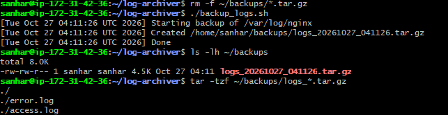
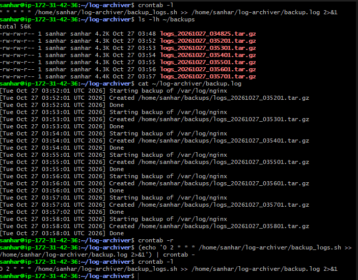
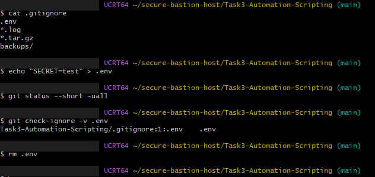

# Task 3: Automated Scripting and Secrets Hygiene

## What I built
A Bash script that compresses and archives Nginx logs, deletes archives older than a retention period, and runs automatically with cron. Configuration lives in a `.env` file that is never committed to Git.

## Steps
1. Wrote `backup_logs.sh` with `set -euo pipefail`; it reads its settings from `.env`.
2. Fixed a permission error by adding my user to the `adm` group (Nginx logs are readable only by root and adm).
3. Tested the script by hand, then with cron every minute, then switched to daily at 2:00 AM.
4. Added a `.gitignore` (blocks `.env`, logs and archives) and a `.env.example` with placeholder values.

## Commands used
    chmod +x backup_logs.sh
    chmod 600 .env
    sudo usermod -aG adm sanhar
    crontab -l
    0 2 * * * /home/sanhar/log-archiver/backup_logs.sh >> /home/sanhar/log-archiver/backup.log 2>&1
    git check-ignore -v .env

## Evidence

### 1. Manual run and archive contents

### 2. Cron running every minute, then the daily schedule

### 3. Secrets hygiene: .env is ignored by Git

## What I learned
- Cron has a minimal environment, so always use absolute paths.
- Secrets belong in `.env`, ignored by Git, with a `.env.example` for others.
- A committed secret must be rotated; deleting the file does not remove it from Git history.
- Group changes only apply to new login sessions.
